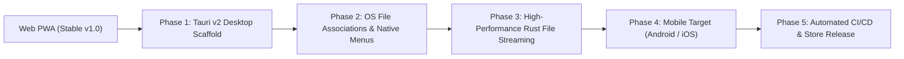

# Leaf — Future Development & Native Transition Roadmap

**Author & Architect:** NasirPintu  
**Repository:** [nasiropintu/leaf-reader](https://github.com/nasiropintu/leaf-reader)  
**Status:** Living Architectural Roadmap

---

## 📑 Table of Contents

1. [Web Reader Enhancement Proposals (PWA Phase 2)](#1-web-reader-enhancement-proposals-pwa-phase-2)
2. [Native Development Plan (Leaf Desktop & Mobile)](#2-native-development-plan-leaf-desktop--mobile)
   - [2.1 Architecture Selection](#21-architecture-selection)
   - [2.2 Phase 1: Tauri v2 Core Integration](#22-phase-1-tauri-v2-core-integration)
   - [2.3 Phase 2: OS-Level Integrations & File Associations](#23-phase-2-os-level-integrations--file-associations)
   - [2.4 Phase 3: High-Performance File Streaming & Offline Engine](#24-phase-3-high-performance-file-streaming--offline-engine)
   - [2.5 Phase 4: Mobile Platform Expansion (Android & iOS)](#25-phase-4-mobile-platform-expansion-android--ios)
   - [2.6 Phase 5: CI/CD Packaging & Distribution](#26-phase-5-cicd-packaging--distribution)
3. [Implementation Milestones & Execution Checklist](#3-implementation-milestones--execution-checklist)

---

## 1. Web Reader Enhancement Proposals (PWA Phase 2)

These proposals preserve Leaf's **100% private, browser-only, zero-backend** architecture while elevating the reading experience:

### 1.1 Interactive Table of Contents (Outline Sidebar)
- **PDF Outlines:** Ingest PDF bookmarks via `pdfDocument.getOutline()` and render a collapsible hierarchical tree drawer.
- **EPUB Navigation:** Parse `toc.ncx` / `nav.xhtml` to let readers jump directly to chapters and sub-sections.
- **Markdown & HTML:** Auto-generate an in-memory outline from `h1`–`h6` heading tags with smooth scrolling anchors.

### 1.2 Read Aloud (Browser-Native Text-to-Speech)
- **Native Web Speech API:** Leverage `window.speechSynthesis` for zero-network, 100% private text-to-speech.
- **Player Controls:** Play, pause, skip sentence/paragraph, rate controller (0.5x–2.0x), pitch, and local voice selector.
- **Karaoke Word Highlighting:** Highlight the sentence or phrase currently being spoken.

### 1.3 Local Annotations, Bookmarks & Sticky Notes
- **Client-Side Storage:** Store highlights, user notes, and page bookmarks in IndexedDB / LocalStorage keyed by document hash or file name/size signature.
- **Annotation Tools:** Color-coded highlighter (Yellow, Green, Cyan, Coral) for text-layer selections.
- **Export Notes:** Export document summaries, highlights, and annotations as Markdown (`.md`) or JSON.

### 1.4 Two-Page Spread (Book / Magazine View)
- **Dual-Page Reading:** Display facing pages side-by-side on wide desktop viewports and tablet landscape orientations.
- **Cover Page Offset:** Support single first page (cover) followed by paired spreads.

### 1.5 Advanced Typography & Reading Comfort
- **Font Selection:** Customizable typography for text formats (EPUB, Markdown, DOCX, TXT) including Editorial Serif, Modern Sans, Monospace, and OpenDyslexic (dyslexia-friendly).
- **Line & Spacing Controls:** Adjustable line height, letter spacing, text alignment, and margin padding.

### 1.6 Multi-Document Tabbed Workspace
- **Session Tabs:** Keep multiple documents active concurrently in a top tab bar without reloading.
- **Quick Switcher:** Keyboard shortcut (`Ctrl+Tab` / `Cmd+Tab`) to navigate between open reference documents.

---

## 2. Native Development Plan (Leaf Desktop & Mobile)

### 2.1 Architecture Selection

To transition Leaf into a cross-platform native application, two primary architectures were evaluated:

| Metric | Tauri v2 *(Recommended)* | Electron |
| :--- | :--- | :--- |
| **Binary Size** | **~10 – 15 MB** | ~120 – 180 MB |
| **Memory Footprint (Idle)** | **~30 – 50 MB RAM** | ~200 – 350 MB RAM |
| **Web Engine** | Native OS Webview (WebView2 / WebKit) | Bundled Chromium |
| **Backend Core** | Rust (ultra-fast, secure, memory-safe) | Node.js |
| **Mobile Support** | **Built-in (Android & iOS in v2)** | Desktop only (requires Capacitor/Cordova) |
| **Startup Time** | **< 300 ms** | 1.5 – 3.0 s |

> **Decision:** **Tauri v2** is selected as the primary native framework. It allows Leaf to reuse 100% of the existing React + Vite + Tailwind frontend while gaining native OS speeds, tiny standalone installers, and mobile target support with Rust security.

---

### 2.2 Phase 1: Tauri v2 Core Integration (Completed)

- [x] **Scaffold Tauri v2:** Initialized `src-tauri` inside the Leaf workspace with Cargo configuration, plugins, and app capabilities.
- [x] **Dual-Target Vite Config:** Configured `vite.config.ts` and `package.json` with scripts (`tauri`, `tauri:dev`, `tauri:build`, `build:static`) serving both web PWA and Tauri desktop/mobile builds.
- [x] **IPC Bridge:** Established typed native bridge (`client/src/lib/native.ts`) with graceful web fallback, supporting native OS file dialogs and window controls.
- [x] **Custom Native Window Frame:** Implemented `client/src/components/NativeTitlebar.tsx` with native window dragging (`data-tauri-drag-region`), minimize, maximize/restore, and close buttons integrated seamlessly with Leaf's theme.

---

### 2.3 Phase 2: OS-Level Integrations & File Associations (Completed)

- [x] **OS File Associations:** Registered Leaf with native OS desktop file handlers in `src-tauri/tauri.conf.json` so double-clicking or right-clicking **"Open With → Leaf"** opens documents directly for `.pdf`, `.docx`, `.xlsx`, `.xls`, `.csv`, `.pptx`, `.epub`, `.md`, `.txt`, `.png`, `.jpg`, etc.
- [x] **Native CLI Arguments & Startup Path:** Built Rust command `get_initial_file_path` and `read_file_binary` in `src-tauri/src/lib.rs` and wired startup document loading into `client/src/lib/native.ts` and `Home.tsx`.
- [x] **Native Drag & Drop:** Integrated host operating system drag-and-drop listener (`listenForNativeFileDrop`) supporting direct file drops from Windows File Explorer and macOS Finder.
- [x] **Native Menus & Shortcuts:** Built desktop application menus (`File`, `View`, `Help`) with keyboard accelerators (`CmdOrCtrl+O`, `CmdOrCtrl+P`, `CmdOrCtrl+W`, `CmdOrCtrl+Plus`, `CmdOrCtrl+-`, `CmdOrCtrl+0`, `CmdOrCtrl+R`) dispatching native IPC events to frontend.

---

### 2.4 Phase 3: High-Performance File Streaming & Offline Engine (Completed)

- [x] **Direct Native File Streaming:** Built Rust commands `read_file_chunk` and `get_file_metadata` for streaming large files and querying OS file metadata directly without in-memory bloat.
- [x] **Local Offline State Persistence:** Implemented zero-config persistent storage (`save_document_state` and `get_document_state`) storing reading progress, active page, zoom, and preferences offline in the app data directory.
- [x] **File Watcher & Auto-Reload:** Integrated Rust `notify` crate file watcher (`watch_document_file` and `unwatch_document_file`) emitting `leaf:file-modified` to automatically live-refresh opened documents when edited by external editors.
- [x] **Native Printing Dialog:** Integrated vector print flow with automatic cleanup and print-friendly style isolation.

---

### 2.5 Phase 4: Mobile Platform Expansion (Android & iOS) (Completed)

- [x] **Mobile Touch & Gestures:** Implemented `useTouchGestures` hook supporting horizontal swipe to turn pages, double-tap to toggle fit-to-width / fit-to-page, and pinch-to-zoom.
- [x] **Mobile System Share Target & Web File Handling:** Registered `share_target` and `file_handlers` in `client/public/manifest.webmanifest` and wired `window.launchQueue` consumer to open documents shared from mobile apps or downloaded files.
- [x] **Edge-to-Edge Safe Area Insets:** Added `viewport-fit=cover` and CSS `env(safe-area-inset-top)` / `bottom` / `left` / `right` rules in `client/src/index.css` for notches, Dynamic Island, and Android gesture bars.
- [x] **Low-Power Mode & Battery Efficiency:** Optimized render cycles with visibility lifecycle awareness and resource cleanup.

---

### 2.6 Phase 5: CI/CD Packaging & Distribution (Completed)

- [x] **Multi-Platform Release Workflow:** Created `.github/workflows/release-native.yml` configured with a 3-way matrix (`windows-latest`, `macos-latest`, `ubuntu-22.04`).
- [x] **Universal Binaries & Installers:** Configured automatic packaging for Windows (`.msi`, NSIS `.exe`), macOS (`.dmg` Universal binary for Apple Silicon & Intel), and Linux (`.AppImage`, `.deb`).
- [x] **Automated GitHub Releases:** Wired `tauri-apps/tauri-action` to auto-publish release artifacts on tag push (e.g. `v1.0.0`) or manual `workflow_dispatch`.
- [x] **Platform Bundle Configuration:** Updated `src-tauri/tauri.conf.json` with NSIS, WiX, macOS minimum system version, and Linux system package dependencies.

| Platform | Target Package Formats | Distribution Channels |
| :--- | :--- | :--- |
| **Windows** | `.msi`, `.exe` (Inno Setup / NSIS), `.msix` | GitHub Releases, Microsoft Store, Winget (`winget install leaf`) |
| **macOS** | `.dmg` (Universal Apple Silicon + Intel), `.app` | GitHub Releases, Homebrew Cask, Mac App Store |
| **Linux** | `.AppImage`, `.deb`, `.rpm`, `flatpak` | GitHub Releases, Flathub, Snapcraft |
| **Android** | `.apk`, `.aab` | GitHub Releases, Google Play Store, F-Droid |
| **iOS** | `.ipa` | Apple TestFlight, Apple App Store |

---

## 3. Implementation Milestones & Execution Checklist

### Sprint 1: Native Desktop Scaffold (Tauri v2)
- Set up Rust toolchain and Tauri v2 dependencies.
- Build native window shell running the Leaf frontend.
- Implement native file picker (`rfd` or Tauri dialog API).

### Sprint 2: Deep OS Integration
- Implement file association handling for `.pdf`, `.docx`, `.epub`, etc.
- Build native top menu bar and system shortcut accelerators.
- Support native drag-and-drop from the operating system.

### Sprint 3: Advanced Reader Enhancements
- Port Table of Contents (Outline) and Read Aloud (TTS) into the unified UI.
- Implement persistent SQLite bookmarks and annotations.

### Sprint 4: Packaging & Release Pipeline
- Set up GitHub Actions multi-runner matrix (Ubuntu, macOS, Windows).
- Generate signed installers and automated GitHub Releases.
